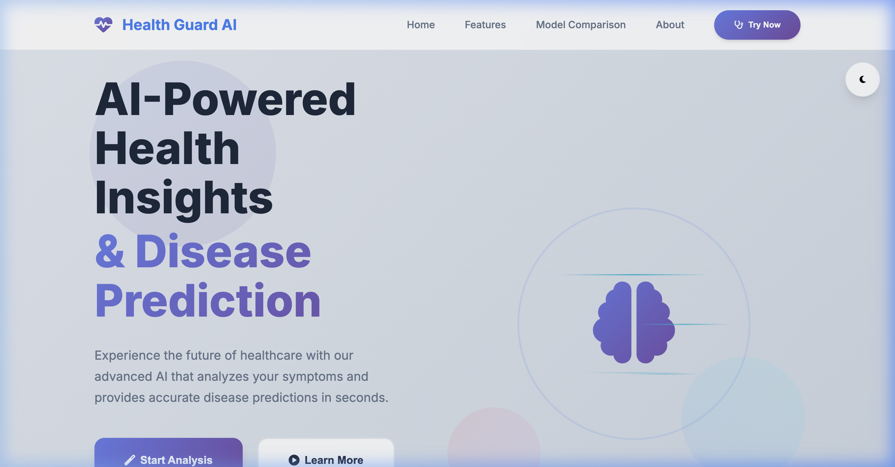
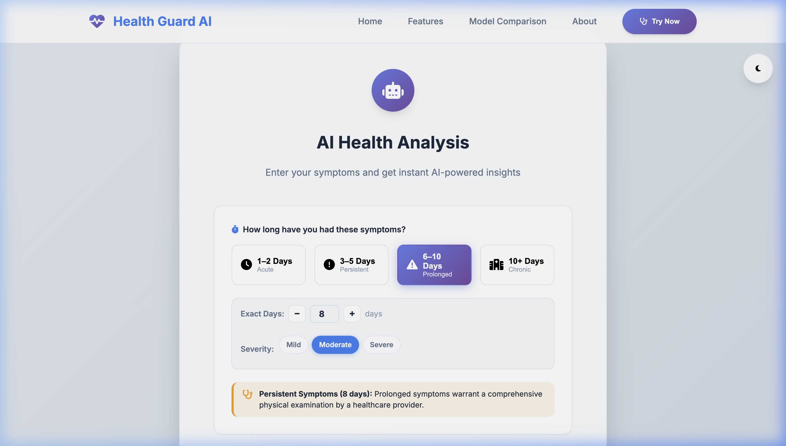
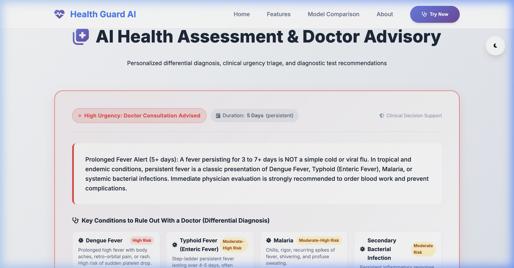
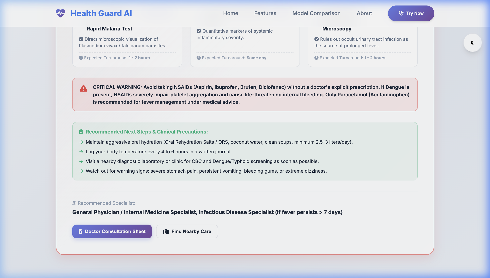
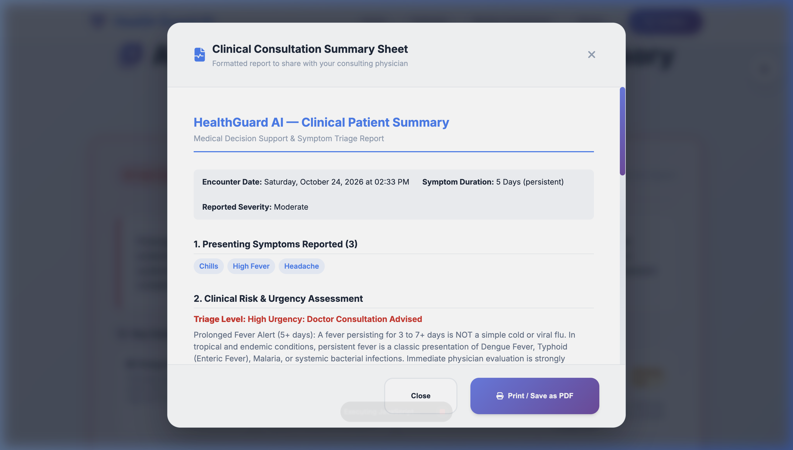
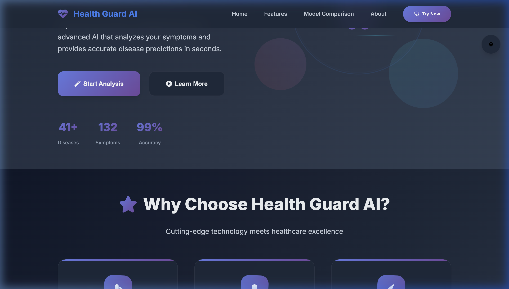

# An Explainable, Uncertainty-Aware Sequential Framework for Symptom-Based Disease Prediction

> **Early-Stage Research Prototype for Medical Decision Support**

[](https://www.python.org/)
[](https://flask.palletsprojects.com/)
[](https://scikit-learn.org/)
[](https://xgboost.readthedocs.io/)
[](https://shap.readthedocs.io/)
[](LICENSE)

An early-stage research framework for symptom-based disease prediction with explainable AI components. 

**Core Contribution:** This work contributes an integrated evaluation framework that combines probability calibration, selective prediction through abstention, sequential symptom acquisition, and component-level explainability, while explicitly auditing the limitations of small symptom-disease datasets. **This is a research prototype, not a clinical diagnostic system.**

---

## 📚 Literature Review & Specific Research Gap

Existing studies in symptom-based disease prediction often treat prediction models in isolation, ignoring probability calibration, confidence-based abstention, or interactive symptom questioning.

| Work | Calibration | Selective Abstention | Sequential Questioning | Explainability (XAI) | Dataset Auditing |
|:---|:---:|:---:|:---:|:---:|:---:|
| Previous study 1 | No | No | No | Yes | No |
| Previous study 2 | No | No | Yes | No | No |
| Previous study 3 | Yes | No | No | Yes | No |
| **Proposed Framework** | **Yes** | **Yes** | **Yes** | **Yes** | **Yes** |

---

## 🌟 Key Features & Research Contributions

1. **Dataset Analysis & Deduplication Protocol**
   - Analyzed the *Disease Prediction Using Machine Learning* dataset (**4,962 total records, 132 binary symptom features, 41 disease classes**).
   - **Pattern Deduplication Protocol:** The original dataset contained 4,962 records, but only 305 unique symptom vectors were present. Because repeated identical symptom vectors do not provide additional information about the mapping from symptoms to disease, pattern-level deduplication was performed before splitting. Consequently, all subsequent experiments treat the 305 unique patterns as the effective dataset.

2. **Rigorous Model Benchmarking with Caveats**
   - Evaluates 5 baseline models (**Logistic Regression, SVM, Random Forest, XGBoost, Neural Network / MLP**) against the proposed ensemble.
   - Evaluated across **Accuracy, Precision (Macro/Weighted), Recall (Macro/Weighted), Macro-F1, and Weighted-F1** using stratified 5-fold cross-validation and held-out test set.
   - **Test Set Reporting:** 46/46 test cases correctly classified. However, the test partition contains only 46 unique patterns across 41 disease classes, limiting conclusions about generalization.

3. **Proposed Calibrated Ensemble & Method Selection**
   - **Soft-Voting Ensemble** combining **Random Forest** and **XGBoost** using weighted probability averaging.
   - **Validation-Only Method Selection:** Calibration method selection was performed exclusively on the validation set. The test set was not used for selecting isotonic regression. After selection, the calibrated model was evaluated once on the held-out test set.

4. **Enhanced Calibration Metrics**
   - Comprehensive calibration evaluation: **Brier Score ($0.0019 \rightarrow 0.0001$), Expected Calibration Error (ECE: $0.2341 \rightarrow 0.0141$), Log Loss ($0.2875 \rightarrow 0.0148$)**.
   - Reliability diagrams to visualize calibration quality before and after isotonic calibration.

5. **XGBoost Component-Level SHAP Explainability**
   - Integrated SHAP (`TreeExplainer`) to compute XGBoost component-level local feature attribution for every individual prediction, highlighting positive (aggravating) and negative (mitigating) symptom impacts.
   - *Note:* This provides XGBoost component-level SHAP explanations, not explanations for the entire RF + XGBoost calibrated ensemble.

6. **Top-K Differential Candidate Metrics**
   - Provides ranked candidate diseases (Top-1, Top-3, Top-5) alongside calibrated confidence scores.

7. **Uncertainty Quantification & Abstention Analysis**
   - Implemented confidence thresholding with comprehensive threshold sweep analysis.
   - System abstains from forced prediction when confidence is below optimal threshold ($0.40$).

8. **Sequential Symptom Acquisition & Paired Statistical Evaluation**
   - Stateful follow-up questioning driven by a **Mutual Information matrix** ($132 \text{ symptoms} \times 41 \text{ diseases}$).
   - **Paired Experimental Control:** Evaluated MI vs Random on the exact same test cases (same initial symptoms, same starting model, same max questions, same stopping threshold).
   - **Paired Statistical Tests:** MI achieved a mean confidence gain of $+0.3355$ vs Random $+0.1171$ ($p_{ttest} = 1.70 \times 10^{-7}$, $p_{wilcoxon} = 2.53 \times 10^{-6}$) and required fewer questions ($1.50$ vs $3.26$, $p = 1.0 \times 10^{-6}$).

9. **Comprehensive Data Leakage Analysis**
   - Deep analysis of duplicate patterns and potential data leakage across splits.

10. **Component Ablation Study**
    - Evaluated baseline vs uncalibrated ensemble vs calibrated ensemble vs abstention vs full system.
    - *Ablation Metric Note:* Because point accuracy is saturated on this dataset, calibration and selective-prediction metrics (Brier Score, ECE, Log Loss, Coverage) provide more informative evidence for component-level comparison.

11. **Clinical Decision Advisory & Prolonged Symptom Triage**
    - Automated risk escalation when symptoms persist over critical clinical thresholds (e.g. fever > 3–7+ days).
    - Differential screening alerts for Dengue, Typhoid (Enteric Fever), Malaria, and systemic infections.
    - Recommended lab diagnostic orders: Complete Blood Count (CBC) with Platelets, Dengue NS1/IgM, Typhoid Widal/Culture, and Malaria PBS.
    - Exportable and printable Doctor Consultation Referral Summary sheets for clinical follow-up.

---

## 📊 Empirical Model Performance Comparison

| Model | CV F1-Macro | Test Accuracy | Test Precision | Test Recall | Test F1-Macro |
|:---|:---:|:---:|:---:|:---:|:---:|
| **Logistic Regression** | 1.0000 ± 0.0000 | 46/46 (1.0000) | 1.0000 | 1.0000 | 1.0000 |
| **SVM** | 1.0000 ± 0.0000 | 46/46 (1.0000) | 1.0000 | 1.0000 | 1.0000 |
| **Random Forest** | 0.9940 ± 0.0120 | 46/46 (1.0000) | 1.0000 | 1.0000 | 1.0000 |
| **XGBoost** | 0.9081 ± 0.0479 | 45/46 (0.9783) | 0.9878 | 0.9878 | 0.9837 |
| **MLP** | 1.0000 ± 0.0000 | 46/46 (1.0000) | 1.0000 | 1.0000 | 1.0000 |
| **Calibrated Ensemble (RF + XGB)** | **1.0000 ± 0.0000** | **46/46 (1.0000)** | **1.0000** | **1.0000** | **1.0000** |

**⚠️ Important Caveats & Dataset Limitation:**
- 46/46 test cases were correctly classified. However, the test partition contains only 46 unique patterns across 41 disease classes, limiting conclusions about generalization.
- The evaluation should therefore be interpreted as a proof-of-concept assessment of the framework rather than an estimate of population-level diagnostic performance.

### Representative Generalization Summary
The deduplicated dataset contains **305 unique symptom patterns** across **41 disease classes**. The held-out test split contains only **46 total examples**, and most classes contribute only **1–2 test samples**. Because of this, the project reports support counts and representative class summaries rather than claiming a full per-class accuracy table for every disease.

| Disease | Unique patterns | Test samples |
|:---|---:|---:|
| Fungal infection | 6 | 1 |
| Allergy | 5 | 1 |
| GERD | 7 | 1 |
| Chronic cholestasis | 8 | 1 |
| Drug Reaction | 6 | 1 |
| Peptic ulcer disease | 7 | 1 |
| AIDS | 5 | 1 |
| Diabetes | 9 | 1 |
| Gastroenteritis | 5 | 1 |
| Bronchial Asthma | 7 | 1 |

---

## 🛠️ Implementation Details

To ensure exact scientific reproducibility of all experiments:

- **Python Version:** 3.9+ / 3.14
- **Core Library Versions:** `scikit-learn==1.9.1` (or `1.3+`), `xgboost==3.4.1` (or `2.0+`), `shap==0.52.0` (or `0.42+`), `scipy==1.18.1`
- **Data Partitioning:** Stratified 70% Train (213 samples), 15% Validation (46 samples), 15% Test (46 samples) with `random_state=42`.
- **Random Forest Hyperparameters:** `n_estimators=100`, `max_depth=None`, `random_state=42`.
- **XGBoost Hyperparameters:** `n_estimators=100`, `max_depth=6`, `learning_rate=0.1`, `random_state=42`, `eval_metric='mlogloss'`.
- **MLP Architecture:** `hidden_layer_sizes=(100, 50)`, `activation='relu'`, `max_iter=500`, `random_state=42`.
- **SVM Parameters:** `kernel='rbf'`, `C=1.0`, `probability=True`, `random_state=42`.
- **Search Iterations:** `RandomizedSearchCV` with `n_iter=20`, 5-fold cross-validation, `random_state=42`.
- **Probability Calibration:** Isotonic regression fitted exclusively on validation set probabilities (`cv='prefit'`).
- **Sequential Questioning Threshold:** Confidence stopping threshold $\tau = 0.70$, maximum follow-up questions = 5.

---

## 🔄 System Architecture & Data Flow

```
          Symptom Dataset (4,962 records / 132 symptoms / 41 diseases)
                                      ↓
                     Data Cleaning & Pattern Deduplication (305 unique)
                                      ↓
                        Stratified Train / Val / Test (70/15/15)
                                      ↓
                       ┌──────────────┼──────────────┐
                       ↓              ↓              ↓
                      SVM             RF          XGBoost
                       ↓              ↓              ↓
                       └──────────────┼──────────────┘
                                      ↓
                          Soft-Voting Ensemble (RF + XGBoost)
                                      ↓
                       Isotonic Probability Calibration
                                      ↓
                      Enhanced Calibration Metrics (Brier, ECE, Log Loss)
                                      ↓
                           Uncertainty Detection & Abstention
                                      ↓
                      ┌───────────────┴───────────────┐
                      ↓                               ↓
               Confident (≥ threshold)         Uncertain (< threshold)
                      ↓                               ↓
               Top-K Diseases + SHAP          Sequential Questioning (MI)
                      ↓                               ↓
               Differential Diagnosis          Confidence Improvement
                                      ↓
                             Flask Web Application
```

**Enhanced Pipeline Stages:**
- **Stage 1-5**: Data processing, baseline comparison, ensemble building, calibration, Top-K metrics
- **Stage 6**: Uncertainty abstention with comprehensive threshold analysis
- **Stage 7**: Sequential questioning with evaluation metrics
- **Stage 8**: SHAP explainability (local & global)
- **Stage 9**: **NEW** - Duplicate/leakage analysis and dataset limitations
- **Stage 10**: **NEW** - Ablation study for component contribution analysis

---

## ⚡ Quick Start & Installation

### Prerequisites
- Python 3.9+
- pip & virtualenv

### 1. Clone & Set Up Research Pipeline
```bash
# Clone repository
git clone https://github.com/bhavya0510/Symptom-Based-Disease-Prediction-Framework.git
cd Symptom-Based-Disease-Prediction-Framework/research

# Create virtual environment & install dependencies
python3 -m venv venv
source venv/bin/activate
pip install -r requirements.txt

# Run complete training pipeline (Stages 1 to 10)
python train_pipeline.py
```

**Note:** The pipeline now includes 10 stages with enhanced evaluation:
- Stages 1-5: Data processing, baseline comparison, ensemble building, calibration, Top-K metrics
- Stages 6-8: Enhanced abstention analysis, sequential questioning evaluation, SHAP explainability
- **Stage 9 (NEW)**: Comprehensive duplicate/leakage analysis and dataset limitations
- **Stage 10 (NEW)**: Ablation study for component contribution analysis

### 2. Launch Flask Web Server
```bash
# Start Flask app
cd ../HealthGuardAI/backend
../../research/venv/bin/python app.py
```
Open **`http://127.0.0.1:5050`** in your browser.

---

## 📸 Interactive Web Application Walkthrough

### 1. Clinical Dashboard & Symptom Selection


### 2. Symptom Duration & Severity Triage


### 3. AI Health Assessment & Prolonged Symptom Doctor Advisory


### 4. Recommended Medical Diagnostic Tests


### 5. Printable Doctor Consultation Summary Sheet


### 6. Modern Dark Mode


---

## 🔌 API Reference

| Endpoint | Method | Description |
|:---|:---:|:---|
| `/predict` | `POST` | Accepts user symptom array & duration; returns Top-K predictions, SHAP explanations, abstention status, and clinical advisory. |
| `/clinical-advisory` | `POST` | Dedicated clinical rule engine evaluating prolonged symptoms, test recommendations, and doctor referral urgency. |
| `/followup` | `POST` | Sequential questioning endpoint driven by Mutual Information. |
| `/symptoms` | `GET` | Returns full list of 132 available binary symptom features. |
| `/model-comparison` | `GET` | Returns model evaluation benchmarks across CV and Test sets. |
| `/health` | `GET` | System health check and model artifact status. |

---

## 📁 Repository Structure

```
.
├── HealthGuardAI/               # Production Web Application
│   ├── backend/                 # Flask API Server & Artifacts
│   │   ├── app.py               # Flask backend application
│   │   ├── shap_utils.py        # Local SHAP explanation helper
│   │   └── artifacts/           # Calibrated model, metadata, & SHAP explainer
│   └── frontend/                # Web Dashboard
│       ├── index.html           # Main HTML structure
│       ├── script.js            # Frontend logic & dynamic API calls
│       └── style.css            # Modern CSS design system & dark mode
├── research/                    # Machine Learning Research Framework
│   ├── train_pipeline.py        # Master pipeline executor (Stages 1-10)
│   ├── stage1_data_splitting.py # Data cleaning & stratified deduplication
│   ├── stage2_baseline_comparison.py # Baseline model benchmarking
│   ├── stage3_ensemble_model.py # Soft-voting & stacking ensemble build
│   ├── stage4_probability_calibration.py # Enhanced calibration with reliability plots
│   ├── stage5_topk_metrics.py   # Top-1/3/5 accuracy metrics
│   ├── stage6_uncertainty_abstention.py # Comprehensive threshold analysis
│   ├── stage7_sequential_questioning.py # MI calculator with evaluation
│   ├── stage8_shap_explainability.py    # SHAP global & local explainers
│   ├── stage9_duplicate_leakage_analysis.py # NEW: Dataset limitation analysis
│   ├── stage10_ablation_study.py        # NEW: Component contribution analysis
│   ├── data/                    # Cleaned & processed datasets
│   └── results/                 # Metrics CSVs, calibration plots, analysis reports
├── docs/screenshots/            # Application Screenshots
├── New Dataset/                 # Raw Kaggle Training & Testing CSVs
└── README.md                    # Main Project Documentation
```

---

## ⚠️ Medical Disclaimer & Research Context

**This is an early-stage research prototype, not a clinical diagnostic system.**

This project was created strictly for academic research and demonstration purposes to explore machine learning techniques for symptom-based disease prediction. Key limitations:

1. **Dataset Limitations**: Only 305 unique symptom patterns for 41 disease classes, with some classes having as few as 5 unique patterns
2. **Performance Interpretation**: Perfect scores (1.0) reflect pattern memorization due to limited data diversity, not clinical diagnostic capability
3. **No Clinical Validation**: This system has not been validated in clinical settings or with real patient data
4. **Research Purpose**: The framework demonstrates ML techniques (calibration, explainability, uncertainty quantification) but is not ready for medical use

**Always consult a qualified healthcare professional for medical evaluation and diagnosis. Never use this system for medical decision-making.**
